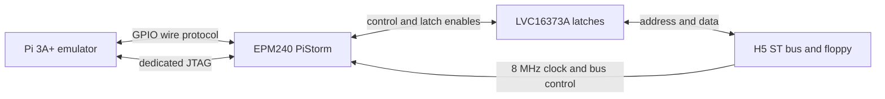

# CPLD test system

| Component | Tested configuration |
|---|---|
| Computer | Phoenix H5, stock STFM-compatible hardware |
| Physical bus clock | Approximately 8 MHz from the H5 |
| Adapter | Older Amiga-style DIP64 PiStorm in the 68000 socket; PCB revision unknown |
| CPLD | MAX II EPM240T100I5N |
| External latches | LVC16373A transparent latches; RTL uses its LS374 compatibility timing |
| Pi | Raspberry Pi 3A+ (BCM2837) |
| Software | Existing `pistorm-atari-jit` emulator/configuration; EmuTOS |
| CPU speed setting | 16 MHz emulated 68000; software pacing, not the physical CPLD clock |
| Build host | WSL2 with rootless Podman, Quartus Lite 20.1.1.720 |

The emulator's `cpu_speed 16mhz` setting controls its interpreter governor;
it is ignored with JIT enabled. The exact JIT/interpreter selection, Pi OS,
emulator revision and benchmark scores were not recorded. Do not interpret
this as a measured 16 MHz physical bus or a JIT performance result.

## Reported hardware results (2026-10-25)

1. Rebuilt the unmodified 1.1b EPM240 source from upstream revision
   `649ec70ada5884facf9924730b33941c6476f208` using the reconstructed project.
   The rebuilt payload differs from the shipped SVF. Program and separate
   verify SVFs both completed without errors on the Pi; the H5 booted EmuTOS.
2. Programmed the patched EPM240 RC1 and tested with the same emulator setup.
   The user reports both images boot and run Gembench loaded from floppy.

RC1 EPM240 source SHA256:
`077505eeb525b795c1e4b1009c8d228f74f4ca327e714cda05180ee9afb956aa`.
This PR keeps that Verilog byte-for-byte. The consolidated build wrapper also
reproduces the RC1 program/verify SVF command streams and payload exactly;
file header comments differ by build path/time. A successful flash verifies contents;
the desktop/floppy result supplies initial functional hardware evidence.
ACSI, extended stability, fault injection and EPM570 hardware were not tested.

For the next comparison, preserve the same emulator/configuration and record
the SVF checksum, boot, repeated floppy reads, expendable-media writes, ACSI
if present, and reset-button behavior. Keep the boot-tested original rebuild
as rollback. Both images report `$421`, so that word cannot distinguish them.
